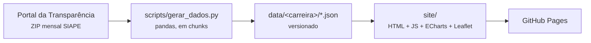

<div align="center">

<a href="https://ariribeiro.github.io/dashboard-carreiras/"></a>

# Painéis de carreiras

**Quantos são, onde trabalham, como está a carreira e quanto recebem.**<br>
Painéis estáticos de carreiras do Executivo Federal, atualizados todo mês com dados do
[Portal da Transparência](https://portaldatransparencia.gov.br/download-de-dados/servidores).

[](https://github.com/ariribeiro/dashboard-carreiras/actions/workflows/atis.yml)
[](https://ariribeiro.github.io/dashboard-carreiras/)
[](#privacidade)

**[Abrir os painéis →](https://ariribeiro.github.io/dashboard-carreiras/)**

</div>

---

## Carreiras

| | Carreira | Painel | Cargo no SIAPE |
|---|---|---|---|
|  | Analista em Tecnologia da Informação | [`/ati/`](https://ariribeiro.github.io/dashboard-carreiras/ati/) | `ANALISTA EM TECNOL DA INFORMACAO` |
|  | Analista Técnico de Políticas Sociais | [`/atps/`](https://ariribeiro.github.io/dashboard-carreiras/atps/) | `ANALISTA TECN EM POLITICAS SOCIAIS` |
|  | Especialista em Políticas Públicas e Gestão Governamental | [`/eppgg/`](https://ariribeiro.github.io/dashboard-carreiras/eppgg/) | `ESP POL PUBL GESTAO GOVERNAMENTAL` |
|  | Analista de Comércio Exterior | [`/ace/`](https://ariribeiro.github.io/dashboard-carreiras/ace/) | `ANALISTA DE COMERCIO EXTERIOR` |
|  | Analista de Infraestrutura | [`/aie/`](https://ariribeiro.github.io/dashboard-carreiras/aie/) | `ANALISTA DE INFRA-ESTRUTURA` |
|  | Auditor Federal de Finanças e Controle | [`/affc/`](https://ariribeiro.github.io/dashboard-carreiras/affc/) | `AUDITOR FEDERAL DE FINANCAS E CONTROLE` |

Os links curtos têm prévia própria para redes sociais e levam a
`/painel.html?carreira=<sigla>`. A página inicial (`/`) lista todas as carreiras.

### O que cada painel mostra

- 📊 **Visão geral**: total de servidores, remuneração mediana, destaques do mês e histórico desde 2013.
- 📉 **Tendência**: ritmo de saídas entre concursos e projeção sem novas turmas.
- 🧾 **Impacto orçamentário** (oculto por enquanto): folha anual estimada e projeção para os
  próximos 10 anos, com comparação entre carreiras na página inicial. Fica oculto até a
  [auditoria dos dados](#auditoria) confirmar os números; a chave é `ORCAMENTO_VISIVEL` em
  `site/orcamento.js`.
- 💡 **Economicidade** (só ATI): estima se órgãos com mais ATI para o volume de contratos de TIC
  perdem menos com acréscimos de valor e preços acima da mediana, quanto isso representa em reais e
  uma projeção para os próximos anos. É um pipeline próprio, veja [Economicidade da ATI](#economicidade).
- 🗺️ **Onde trabalham**: mapa com a sede de cada órgão de exercício, ranking de órgãos e UFs.
- 🪜 **Carreira**: distribuição por classe e padrão, e funções comissionadas.
- 💰 **Remuneração**: histograma, mediana e faixa P10–P90 da remuneração básica bruta.

<a id="privacidade"></a>
> [!NOTE]
> Só são publicados **dados agregados**. Nenhum nome, CPF, matrícula ou
> identificador individual sai do script, e os arquivos brutos do portal nunca
> são commitados (LGPD).
>
> As visitas são medidas com o [GoatCounter](https://www.goatcounter.com), sem
> cookies e sem dados pessoais. Painel de acessos: <https://ariribeiro.goatcounter.com>.

---

## Início rápido

**Ver o site** com os dados que já estão no repositório:

```bash
rm -rf site/data && cp -R data site/data
python3 -m http.server -d site 8000
```

Abra <http://localhost:8000>. A página precisa de um servidor, porque abrir o
`index.html` direto faz o navegador bloquear a leitura dos JSON. Refaça a cópia
de `data/` sempre que os dados mudarem.

**Gerar dados** (opcional, o workflow faz isso todo mês):

```bash
python3 -m venv .venv
.venv/bin/pip install -r requirements.txt

.venv/bin/python scripts/gerar_dados.py                    # mês mais recente, todas as carreiras
.venv/bin/python scripts/gerar_dados.py --mes 202607       # um mês específico
.venv/bin/python scripts/gerar_dados.py --ano 2025         # todos os meses publicados do ano
.venv/bin/python scripts/gerar_dados.py --carreira atps    # só uma carreira (pode repetir)
.venv/bin/python scripts/gerar_dados.py --force            # reprocessa meses existentes
.venv/bin/python scripts/gerar_dados.py --manter-zip       # guarda o ZIP em .cache/
```

Cada mês baixa um ZIP de ~85 MB. Depois do download, o processamento leva
poucos segundos e usa cerca de 250 MB de RAM.

---

## Como funciona



| Parte | O que faz |
|---|---|
| [`scripts/gerar_dados.py`](scripts/gerar_dados.py) | Descobre os meses publicados, baixa o ZIP `AAAAMM_Servidores_SIAPE` **uma vez**, lê cadastro e remuneração em chunks, separa cada carreira e grava os agregados. Um mês só é baixado se faltar para alguma carreira. |
| [`data/carreiras.json`](data/carreiras.json) | Configuração das carreiras (lida pelo script e pelo site). |
| `data/<carreira>/` | `AAAAMM.json` (agregados do mês), `latest.json` (mês mais recente) e `index.json` (série com total e mediana). |
| [`data/orgaos_coordenadas.csv`](data/orgaos_coordenadas.csv) | Sede de cada órgão de exercício, para o mapa. |
| [`site/`](site/) | HTML, CSS e JS puros, sem build. `painel.html` lê a carreira do endereço. |
| [`scripts/economicidade_ati.py`](scripts/economicidade_ati.py) e [`.github/workflows/economicidade.yml`](.github/workflows/economicidade.yml) | Pipeline só da ATI: coleta contratos de TIC (Compras.gov.br e PNCP), estima o efeito do efetivo de ATI e grava `data/ati/economicidade.json`. Roda por trimestre. Veja [Economicidade da ATI](#economicidade). |
| [`.github/workflows/atis.yml`](.github/workflows/atis.yml) | Roda no dia 15 de cada mês (12h UTC) ou manualmente: gera os dados, commita `data/` e publica no Pages. |
| [`scripts/auditar.py`](scripts/auditar.py) e [`.github/workflows/auditoria.yml`](.github/workflows/auditoria.yml) | Conferem os dados publicados e gravam um registro em `auditoria/`. Veja [Auditoria](#auditoria). |

<details>
<summary><strong>Campos de <code>data/carreiras.json</code></strong></summary>

| Campo | Uso |
|---|---|
| `sigla`, `plural`, `nome`, `nome_plural` | Textos do painel |
| `padrao_cargo` | Regex do cargo no SIAPE (texto sem acentos, maiúsculo) |
| `marca` | `"ati"` usa a marca oficial da ATI; `"neutra"`, a sigla em texto |
| `grupo` | Bloco da página inicial: `"transversais"` (carreiras do MGI) ou `"outras"`. Sem o campo, entra em "Outras carreiras" |
| `ingresso` | Classe e padrão de entrada (`{"classe": "A", "padrao": "I"}`), ou `null` se não confirmado. Sem ele, o painel omite o destaque "no início da carreira" |
| `classes` | Opcional. Rótulo de exibição por código do SIAPE (ex.: `{"S": "Especial"}`) |
| `faixas` | Opcional. Limites (R$) do histograma, para carreiras em outro patamar salarial |
| `inicio` | Opcional. Primeiro mês (`AAAA-MM`) em que a carreira aparece no SIAPE; meses anteriores são ignorados em vez de falhar como "vazio" |
| `atribuicoes` | Opcional. Atribuições do cargo copiadas da lei: `intro`, `itens` (lista) ou `trecho` (frase única), `fonte` (dispositivo legal) e `url` (texto da lei na base da Câmara). O painel mostra o bloco "Atribuições do cargo" na seção Carreira; sem o campo, ele fica oculto |
| `cores` | `destaque` (cor da carreira: faixa, brilho do cabeçalho, cartão da página inicial), `clara` (acento sobre fundo escuro e no modo escuro) e `forte` (acento sobre fundo claro, contraste ≥ 4,5:1). A ATI mantém a identidade oficial no painel |

</details>

<details>
<summary><strong>Como os dados do SIAPE são interpretados</strong></summary>

Conferido no arquivo de ago/2026:

- **Download**: `https://portaldatransparencia.gov.br/download-de-dados/servidores/AAAAMM_Servidores_SIAPE`
  redireciona para um ZIP (~85 MB, ~620 MB descompactado). A lista de meses
  disponíveis vem da própria página do portal.
- **Cargo**: o nome vem abreviado. A regex de cada carreira é aplicada ao texto
  sem acentos e em maiúsculas.
  - **ATI**: deixa de fora cargos parecidos que não são da carreira, como
    `ANALISTA DE TEC DA INFORMACAO` (PCCTAE), `ANALISTA DE TECNOL DA INFORMACAO - 40H`
    (EBSERH) e `ANALISTA - ANALISTA DE TECNOL DA INFORM` (Conab).
  - **ATPS**: aparece no SIAPE a partir de jul/2013, com a primeira turma (toda em A-I); por isso `inicio` é `2013-07`. A lotação só ficou centralizada no MGI em 2024. Classes A–C e padrões I–VI, como a ATI. De ago a dez/2023 o SIAPE traz até 4 servidores em classe S, publicados como vieram.
  - **EPPGG**: hoje classes B, C e S. Pela remuneração, a ordem é B → C → S, e S é
    exibida como "Especial". A classe A aparece de 2013 a nov/2025 e não existe
    mais nos dados recentes; o ingresso não está configurado. Faixas próprias no histograma.
  - **ACE**: a maioria no MDIC. Hoje classes B, C e S ("Especial"); a classe A
    aparece até mai/2024. Ingresso não configurado. Usa as mesmas faixas da EPPGG.
  - **AIE**: espalhados pelos ministérios de infraestrutura. Classes A, B, C e S
    ("Especial"); ingresso não configurado. Não inclui
    `ESPECIALISTA EM INFRA-ESTRUTURA SENIOR` nem
    `ANALISTA EM INFRA-ESTRUT DE TRANSPORTES` (DNIT), que são outros cargos.
  - **AFFC**: carreira única de Finanças e Controle, com servidores em vários órgãos
    (set/2026: ~60% na CGU e ~27% no Ministério da Fazenda, onde está a STN). Entram todos os
    AFFC, sem recorte por órgão; o mapa mostra onde cada um tem exercício. Classes B, C e S
    ("Especial"); ingresso não configurado. Remuneração em patamar mais alto (mediana ~R$ 36,7 mil
    em set/2026), por isso tem faixas próprias no histograma. Não inclui
    `TECNICO FEDERAL DE FINANCAS E CONTROLE`, que é outro cargo da mesma carreira.
- **Função comissionada**: fica numa linha separada do mesmo
  `Id_SERVIDOR_PORTAL`, com `DESCRICAO_CARGO` "Sem informação" e `SIGLA_FUNCAO`
  preenchida (FEX, CCX…). O servidor conta como "com função" quando essa linha existe.
- **UF**: `UF_EXERCICIO` vem `-1` em boa parte das linhas de cargo. Nesses casos
  vale a UF da linha de função ou de exercício descentralizado. Sem nenhuma, o
  servidor entra como "Não informado".
- **Remuneração**: média, mediana, P10, P90 e histograma usam
  `REMUNERAÇÃO BÁSICA BRUTA (R$)`, só com valores maiores que zero no mês. As
  faixas do histograma são fixas por carreira, para que os meses possam ser comparados.

</details>

<details>
<summary><strong>Mapa de órgãos de exercício</strong></summary>

O SIAPE não informa endereço, então a localização vem de uma tabela mantida à
mão, `data/orgaos_coordenadas.csv` (separador `;`, nunca use `;` dentro de um campo):

| Coluna | Conteúdo |
|---|---|
| `orgao_siape` | Nome do órgão **exatamente** como aparece em `ORG_EXERCICIO` |
| `sigla` | Sigla exibida no mapa |
| `nome` | Nome oficial completo (tooltips) |
| `nome_curto` | Nome curto usado nos eixos dos gráficos |
| `local` | Prédio ou endereço da sede |
| `lat`, `lon` | Coordenadas da sede |
| `precisao` | `edificio`, `quadra` ou `rua` |
| `fonte` | De onde vieram o endereço e a coordenada |

- A coordenada é a da **sede**. O servidor pode trabalhar num anexo ou numa
  unidade regional, e o mapa avisa isso.
- Órgãos no mesmo prédio (ex.: Bloco C da Esplanada) viram uma bolinha só.
- Linhas com `lat`/`lon` vazios marcam órgãos sem lugar definido (ex.: "Estados /
  Municípios / Empresas", ou "Tribunal de Justiça" sem estado). Eles aparecem
  na nota abaixo do mapa.
- **Órgão novo**: o script emite um aviso (`::warning::`, visível no resumo da
  execução do Actions) e o órgão aparece como "sem localização" até alguém
  incluir a linha. Para achar a coordenada, busque o prédio em
  [openstreetmap.org](https://www.openstreetmap.org), clique com o botão direito
  → "Mostrar endereço" e copie latitude e longitude.

</details>

<details>
<summary><strong>Tendência sem novos concursos</strong></summary>

Calculada no navegador, só com `data/<carreira>/index.json`:

- Um mês com alta de 10 ou mais servidores é uma **entrada de turma**. Entradas
  separadas por até 2 meses formam uma turma só.
- Nos outros meses mede-se a **taxa de saída líquida** (perda somada ÷ total do
  mês anterior somado), em três cenários: últimos 5 anos, toda a série e pior
  janela de 24 meses.
- A projeção aplica cada taxa ao total mais recente por 15 anos, sem novas
  entradas, e estima quando o total voltaria ao nível de antes das duas últimas turmas.
- A seção fica oculta enquanto a carreira tiver menos de 24 meses processados ou
  nenhuma entrada de turma na série. O cenário da pior janela só aparece quando
  alguma janela de 24 meses tem dados suficientes.

**Limitações:** o dado agregado só mostra o saldo, não quem entrou ou saiu, e
nos meses de entrada as saídas ficam escondidas. Saída inclui exoneração,
aposentadoria e falecimento. A projeção não considera demanda, novas vagas nem
mudanças na carreira.

</details>

<details>
<summary><strong>Impacto orçamentário</strong></summary>

Calculado no navegador por `site/orcamento.js`, usado pelo painel e pela página
inicial, a partir de `n` e `media` do `index.json` de cada carreira:

- **Folha mensal** = servidores com remuneração no mês × remuneração básica bruta
  média. **Folha anual** de um ano = 12 meses + 13º (igual a dezembro). Meses sem
  arquivo são interpolados. **Folha anual hoje** é outra conta: o mês mais recente
  × 13, o custo de um ano inteiro com o efetivo e a remuneração de agora.
- **Efetivo**: "sem novas entradas" usa a taxa de saída líquida dos últimos 5
  anos (a mesma da Tendência); "repondo as saídas" mantém o efetivo atual.
- **Crescimento da remuneração média**: ritmo anual dos últimos 10 anos (média dos
  últimos 12 meses contra a de 12 meses dez anos antes; com menos histórico, usa o
  que houver, no mínimo 3 anos). É o ritmo da média de toda a carreira, sem separar
  classe e padrão, e não o reajuste da tabela: junta reajustes (mesmo os que só
  alcançam parte das posições), progressões e o efeito das turmas novas. O painel
  também mostra a estimativa em valores de hoje, com a média congelada.
- **Página inicial**: as carreiras são comparadas no mês mais recente que todas têm.

**Limitações:** é só a remuneração básica bruta. Não inclui contribuição patronal,
terço de férias, auxílios, funções pagas à parte, nem aposentados e pensionistas.
Reajustes futuros dependem de negociação e de lei.

</details>

---

<a id="economicidade"></a>
## Economicidade da ATI

**Hipótese:** investir na carreira de ATI gera economicidade. O trabalho do ATI (planejar,
fiscalizar e gerir contratos) é função de Estado e **não substitui a terceirização**, então a
comparação não é "salário do ATI × preço de terceirizado". A pergunta é se o dinheiro que o órgão
já gasta com terceiros rende mais quando há mais ATI para geri-lo.

```bash
python scripts/economicidade_ati.py coletar            # consulta as APIs e guarda em .cache/economicidade (retomável)
python scripts/economicidade_ati.py analisar           # painel, regressão, projeção -> data/ati/economicidade.json
python scripts/economicidade_ati.py tudo --orgao 44205 # os dois passos, só um órgão (código do Compras)
python scripts/test_economicidade.py                   # testes, sem rede
```

| Arquivo | Conteúdo |
|---|---|
| [`data/ati/economicidade_orgaos.csv`](data/ati/economicidade_orgaos.csv) | Tabela mantida à mão: nome do órgão no SIAPE → código do Compras. `uso=painel` entra na análise. |
| [`data/ati/economicidade_premissas.json`](data/ati/economicidade_premissas.json) | Encargos sobre a folha, carteira mínima, horizonte, último ano com acompanhamento de aditivos. |
| `data/ati/economicidade.json` | Resultado agregado por órgão e ano, estimativas com intervalo de confiança, economia, projeção, custo e cobertura. |

<details>
<summary><strong>Como é medido</strong></summary>

- **Fontes**: contratos e itens de contrato do [Compras.gov.br](https://dadosabertos.compras.gov.br)
  (`modulo-contratos`), termos aditivos do [PNCP](https://pncp.gov.br) e o efetivo de ATI por órgão de
  exercício dos arquivos mensais do SIAPE já em `data/ati/`.
- **Contrato de TIC**: categoria "Informática (TIC)" **ou** objeto que cita software, nuvem, links,
  licenças etc. O código de categoria `48` aparece com os rótulos "Informática (TIC)" e "Mão de Obra"
  (limpeza), então o filtro usa o **nome** da categoria mais o texto do objeto.
- **Perda**: (acréscimos de valor + excesso de preço acima da mediana do item) ÷ valor contratado.
  Reajuste e repactuação não contam como acréscimo. O campo `valorAcumulado` do Compras **não** serve
  para medir aditivos: chega a 187 vezes o valor global do contrato.
- **Preço**: valor unitário de cada item do catálogo contra a mediana dos órgãos analisados no mesmo
  ano (mínimo de 4 observações em 3 órgãos), sem precisar de deflator.
- **Carga de gestão**: ATIs por R$ 100 milhões de contratos de TIC assinados nos últimos 3 anos.
- **Estimação**: regressão da perda sobre a carga, com efeito fixo de órgão e de ano, ponderada pelo
  valor contratado e com erro-padrão agrupado por órgão (CR1, t com G−1 graus de liberdade). Compara o
  órgão com ele mesmo ao longo do tempo.
- **Veredito**: `confirmada` se o intervalo de 95% fica todo abaixo de zero, `refutada` se fica todo
  acima, `inconclusiva` se inclui zero. A regra é fixa no código.
- **Economia em reais**: −β × carga × valor contratado, com os dois extremos do intervalo de confiança.
  Custo da carreira: folha básica bruta × 13 × (1 + encargos).
- **Projeção**: efetivo da seção Tendência (sem novas entradas e repondo saídas). O modelo é linear;
  o crescimento do volume de contratos não altera a conta.

</details>

<details>
<summary><strong>Limitações</strong></summary>

- **Associação, não causa.** Outras mudanças no órgão podem coincidir com a chegada de ATIs.
- **Amostra**: só entidades vinculadas (código estável). Ministérios mudaram de nome e código em
  2019 e 2023 e ficaram fora; a versão "extrapolada" supõe o mesmo efeito por ATI neles.
- **Período**: termos aditivos no PNCP são consistentes a partir de 2021; contratos recentes ainda não
  tiveram tempo de receber aditivos (`ultimo_ano_com_acompanhamento_aditivos`).
- **Só o que é registrado**: serviço mal entregue, glosa não aplicada e risco evitado não aparecem.
- **Preço de referência interno**: a mediana vem dos órgãos analisados, não de pesquisa de mercado.
- **Tabela de órgãos**: código errado vira "órgão sem contratos" (lista em `cobertura.orgaos_sem_contratos`).
  Ao incluir um órgão, confira o código na [API de órgãos](https://dadosabertos.compras.gov.br/modulo-uasg/2_consultarOrgao).
- **Encargos**: a premissa de 22% (contribuição patronal) precisa ser confirmada na lei antes de publicar.

</details>

---

<a id="auditoria"></a>
## Auditoria

O workflow **Auditoria dos dados** roda depois de cada execução de "Dados das carreiras"
e também manualmente. Cada execução grava um registro em `auditoria/registros/` e
atualiza `auditoria/index.json`; os dois ficam versionados, então o histórico do git
mostra quando cada auditoria foi feita.

| Método | O que confere | Fonte |
|---|---|---|
| `coerencia` | Todos os arquivos de `data/` entre si: somas por órgão, UF, situação e classe iguais ao total; histograma igual a `n`; `index.json` e `latest.json` iguais aos arquivos mensais; filtro de cargo igual ao de `carreiras.json`. | Só o repositório |
| `recontagem` | Baixa o ZIP do mês no portal e recalcula total, órgãos, UFs, classes, funções e remuneração (n, média, mediana, P10, P90, histograma) de cada carreira, comparando com o arquivo publicado. | Portal da Transparência |

A recontagem usa [`scripts/auditar.py`](scripts/auditar.py), que **não compartilha código**
com `gerar_dados.py` nem usa pandas: lê os CSV linha a linha com a biblioteca padrão. Os
dois só têm em comum `data/carreiras.json` e as regras descritas acima. Contagens têm de
bater exatamente; valores em reais, com tolerância de R$ 0,01.

**O que cada registro guarda:** data e hora, método, commit auditado, link da execução,
carreiras e meses conferidos, SHA-256 e tamanho de cada ZIP baixado (mostra contra qual
versão do arquivo do portal a comparação foi feita), número de verificações, cada
divergência com o valor publicado e o recalculado, e avisos. Só agregados entram no registro.

**Amostra:** por padrão a recontagem confere o mês mais recente e sorteia mais dois entre
os que ainda não foram recontados (a semente do sorteio fica no registro).
`cobertura_recontagem`, em `auditoria/index.json`, lista os meses já conferidos.

**Diagnósticos:** a recontagem também registra, por carreira, os cargos aceitos pelo
filtro, cargos parecidos que ele rejeitou, quantos servidores têm mais de uma linha de
remuneração e a mediana de quem tem e de quem não tem função. Não são divergências;
servem para revisar o filtro e entender o que a remuneração somada contém.

**No site:** cada execução também regrava `data/auditoria.json`, um resumo dos registros
(última conferência de coerência de cada carreira, meses já recontados e a lista de
execuções), e republica o site. A página [`/auditoria.html`](https://ariribeiro.github.io/dashboard-carreiras/auditoria.html)
mostra a situação por carreira, os meses recontados e todas as execuções, com link para
cada registro. O rodapé da página inicial resume a situação de todas as carreiras; o do
painel mostra a da carreira e diz se o mês selecionado já foi recontado. Divergências
aparecem no site até serem resolvidas.

**Quando há divergência**, o workflow fica vermelho e grava o registro, mas não altera
`data/`: o portal pode ter republicado o arquivo, ou pode haver erro em um dos scripts, e
isso se decide caso a caso (reprocessar o mês com `force`, ou corrigir o script).

**Limite do método:** a auditoria compara com o arquivo de download do portal. Não
confere com o Painel Estatístico de Pessoal nem com a página individual de cada servidor.

```bash
python scripts/auditar.py coerencia
python scripts/auditar.py recontagem --mes 202609                   # pode repetir --mes
python scripts/auditar.py recontagem --mais-recente --sortear 2
python scripts/auditar.py recontagem --mes 202609 --cache .cache    # usa o ZIP guardado por --manter-zip
python scripts/auditar.py resumo                                    # só regrava data/auditoria.json
```

---

## Publicação e atualização

### Ativar o GitHub Pages

1. Envie o repositório para o GitHub.
2. Em **Settings → Pages → Build and deployment → Source**, escolha **GitHub Actions**.
3. Em **Actions → Dados das carreiras → Run workflow**, rode o primeiro deploy.

### Homologação (Cloudflare Pages)

A produção é o GitHub Pages. Para testar uma versão antes de levá-la ao `main`,
o repositório também está ligado a um projeto no Cloudflare Pages
(`dashboard-carreiras`), que só lê o código:

- Cada push em um branch que não seja o `main` gera um link de pré-visualização
  próprio, no formato `<branch>.dashboard-carreiras.pages.dev`. O link aparece em
  **Workers & Pages → dashboard-carreiras → Deployments**.
- Configuração do projeto: framework `None`, build `cp -r data site/data`, saída `site`.
- O GoatCounter só conta acessos a `ariribeiro.github.io`; visitas à homologação
  não entram nas estatísticas.

### Rodar o workflow manualmente

Em **Actions → Dados das carreiras → Run workflow**:

| Opção | Efeito |
|---|---|
| **mês** + **ano** | Processa um mês específico (ex.: `03` e `2026`). Com "mais recente" e ano em branco, busca o último mês publicado. |
| **mês = "ano inteiro"** + **ano** | Processa todos os meses publicados do ano, pulando os que já existem. Doze meses podem levar perto de uma hora. |
| **carreira** | "todas" (padrão) ou só uma. |
| **force** | Reprocessa mesmo que `data/<carreira>/AAAAMM.json` já exista. |

Pela linha de comando:

```bash
gh workflow run atis.yml -f mes=03 -f ano=2026 -f force=true
gh workflow run atis.yml -f mes="ano inteiro" -f ano=2025 -f carreira=aie
```

### Incluir outra carreira

1. Ache o nome do cargo na coluna `DESCRICAO_CARGO` do cadastro (vem abreviado)
   e escreva uma regex para ele.
2. Acrescente a carreira em `data/carreiras.json` e em `options` da entrada
   `carreira` do workflow. Para link curto, copie `site/atps/` para
   `site/<carreira>/` trocando a sigla.
3. Rode o workflow com "ano inteiro" para cada ano a partir de 2013. As
   carreiras que já têm dados não mudam.
4. Inclua em `data/orgaos_coordenadas.csv` os órgãos que o script apontar nos avisos.

---

## Observações

- **Inatividade**: o GitHub desativa workflows agendados depois de 60 dias sem
  atividade no repositório. Os commits mensais de `data/` costumam bastar; se o
  portal ficar meses sem publicar, reative o workflow em **Actions**.
- **Atraso do portal**: cada mês é publicado com algumas semanas de atraso. Um mês
  já presente em `data/` não é reprocessado.
- **Bloqueio**: a página de download usa AWS WAF. Hoje o download direto funciona,
  mas se o portal bloquear IPs de runners, o job vai falhar no download.
- **Arquivos brutos**: o `.gitignore` impede o commit de ZIPs e CSVs.
- **Estatísticas de acesso**: `index.html` e `painel.html` carregam o script do
  GoatCounter (cada carreira aparece como `painel.html?carreira=<sigla>`). Os links
  curtos redirecionam na hora, então contam a visita eles mesmos, com a origem
  original, e o painel não conta de novo quem chega por eles. Acessos em
  `localhost` não são contados.

<div align="center">
<sub>Desenvolvido por <strong>Ari Ribeiro</strong>, Analista em Tecnologia da Informação ·
<a href="mailto:contato@ariribeiro.dev">contato@ariribeiro.dev</a> ·
<a href="https://www.linkedin.com/in/arivaldo-ribeiro-26472823/">LinkedIn</a></sub>
</div>
